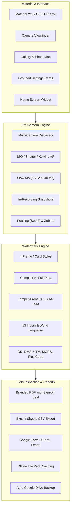

# GeoStamp Camera (Android, Kotlin)

[-brightgreen.svg)](https://developer.android.com)
[-blue.svg)](https://developer.android.com)
[-indigo.svg)](https://m3.material.io)
[](LICENSE)

An enterprise-grade, professional GPS-stamp camera and proof-of-work inspection platform for Android. Built with **Kotlin**, **Jetpack Compose (Material 3)**, **CameraX 1.5**, and **Camera2 Interop**, it combines Blackmagic-style manual cinematography controls with tamper-proof cryptographic geolocation stamping, multi-sensor telemetry, on-device AI vision, offline map pre-caching, and automated compliance reporting.

---

## Table of Contents
- [Architecture & Design System](#architecture--design-system)
- [Core Features Overview](#core-features-overview)
  - [1. Pro Camera & Sensor Engine](#1-pro-camera--sensor-engine)
  - [2. Viewfinder Monitoring & Pro Display Parameters](#2-viewfinder-monitoring--pro-display-parameters)
  - [3. Watermark Engine & Frame Styles](#3-watermark-engine--frame-styles)
  - [4. Proof-of-Work & Inspection Reporting](#4-proof-of-work--inspection-reporting)
  - [5. Offline Map Tile Pre-Caching Engine](#5-offline-map-tile-pre-caching-engine)
  - [6. Smart Extras & On-Device ML Vision](#6-smart-extras--on-device-ml-vision)
  - [7. Android Home Screen Widget & System Integration](#7-android-home-screen-widget--system-integration)
- [Data Sources & Privacy Policy](#data-sources--privacy-policy)
- [Unit Testing & Verification Suite](#unit-testing--verification-suite)
- [Building & Installation](#building--installation)
- [Repository Structure](#repository-structure)

---

## Architecture & Design System

The app is architected around modern Android best practices:
- **Material 3 (Material You):** Full dynamic color theming (`dynamicDarkColorScheme` / `dynamicLightColorScheme` on Android 12+) with professional high-contrast OLED dark theme defaults. Every screen utilizes M3 elevated tonal cards (`ElevatedCard`), segmented buttons (`SingleChoiceSegmentedButtonRow`), tonal assist chips, and standardized typography (`Type.kt`).
- **Reactive Unidirectional Data Flow:** State is managed via Kotlin Coroutines and StateFlows (`CameraController`, `StampDataRepository`, `GalleryState`).
- **Camera2 Interop via CameraX 1.5:** Clean CameraX lifecycle bindings coupled with low-level Camera2 capture requests for manual ISO, nanosecond shutter control, Kelvin color temperature, and manual diopter focus.
- **Hardware Acceleration & Zero-Leak Memory Management:** Bitmaps and Canvas surfaces are pooled and recycled to prevent Out-Of-Memory (OOM) errors during burst and high-resolution photo composition.

---

## Core Features Overview



---

### 1. Pro Camera & Sensor Engine

- **Full Multi-Camera Sensor Access:** Discovers and exposes every physical and logical lens on the device (Ultra-Wide, Wide, Telephoto, Periscope, Macro, Front). Includes an **"All Cameras"** multi-shot mode that triggers rapid sequential captures from every lens.
- **Cinematic Manual Controls:**
  - **ISO:** Auto or manual (ISO 50 to ISO 12800+ depending on sensor limits).
  - **Shutter:** Nanosecond precision exposure time in photo mode; shutter angle (11.2° to 360°, with 180° motion blur default) in video mode.
  - **White Balance:** Presets (Daylight, Cloudy, Shade, Tungsten, Fluorescent) or manual Kelvin (2000K – 10000K) with green/magenta tint bias.
  - **Focus:** Manual diopter slider (0.0 diopters / infinity $\infty$ to macro) with instant Auto-Focus / Manual-Focus toggle.
  - **Exposure Compensation (EV):** Live EV bias adjustment with sensor-reported compensation steps.
- **Video Capabilities:**
  - **Encoders:** H.264 (High Compatibility) vs HEVC / H.265 (High Efficiency).
  - **Dynamic Range:** SDR, HDR10, HDR10+, HLG 10-bit, and Dolby Vision where supported.
  - **Concurrent Still Snapshots:** Take full-resolution stamped photos or Live Moments while video recording without interrupting the stream.
  - **Auto Frame Rate:** Low-light dynamic FPS downshifting (e.g. 60fps $\to$ 30fps/24fps) to maximize exposure time and eliminate grain in dark environments.
  - **Video Bookmark Tagging:** Tap the "🏷 Tag" chip during video recording to bookmark timestamps; exports companion `.tags.json` and chapter metadata.
- **Slow-Motion Capture Mode:** High-speed capture sessions at `2× (60fps)`, `4× (120fps)`, and `8× (240fps)` with live telemetry and speed burn-in.
- **Time-Lapse Mode:** Configurable interval timer (1s, 2s, 5s, 10s, 30s) burning progressive timestamps and coordinate tracking into every frame.
- **Picture-in-Picture (PiP):** Dual-camera overlay capturing front selfie and rear site environment concurrently.
- **Preserve Settings:** 9 granular state persistence toggles ensuring mode, focal length, manual parameters, filters, and EV biases survive app restarts.

---

### 2. Viewfinder Monitoring & Pro Display Parameters

- **Focus Peaking:** Real-time 3x3 Sobel edge-gradient detection running on the luminance plane of `ImageAnalysis`. Masks in-focus high-contrast edges with neon green (`#00FF41`) during manual focusing.
- **Exposure Verification (Zebra Clipping):** Dual-threshold luminance inspection:
  - Highlights severe underexposure ($Y < 16$) in vivid blue.
  - Highlights blown-out overexposure ($Y > 240$) in vivid red.
- **Real-Time Histogram:** 64-bin live luminance curve rendered in square-root scale with under/over-clipping indicator bars.
- **Horizon Level Indicator:** Live 2D pitch and roll accelerometer/gravity sensor overlay with 1° precision green level lock.
- **Composition Grids & Frame Guides:** Rule of Thirds, Crosshair, and cine aspect ratio guides (2.39:1, 2:1, 1.85:1, 1:1, 4:5, 9:16).

---

### 3. Watermark Engine & Frame Styles

GeoStamp features 4 distinct watermark rendering architectures with a toggle between **Full Information Mode** and **Compact / Minimal Mode**:

1. **Classic Geo Badge:** Translucent dark overlay with map thumbnail, address, coordinates, compass, weather, and logo.
2. **Elegant Bottom Bar:** Sleek minimal footer with rounded badge accents, ideal for corporate documentation and clean client presentations.
3. **Professional Framed Card:** Full photo border with metadata card, camera technical parameters, map thumbnail, and official verification seal.
4. **Minimal Film Strip / Technical:** Clean tabular layout with high-contrast mono typography for engineering inspections.

#### Telemetry Fields
- **Coordinates:** Decimal Degrees (DD), Degrees-Minutes-Seconds (DMS), Universal Transverse Mercator (UTM), and Military Grid Reference System (MGRS).
- **Plus Codes:** Offline Open Location Code (OLC) computed directly on-device.
- **Altitude:** Mean Sea Level (MSL) altitude via Geoid height model on Android 14+ (API 34+).
- **Environmental Telemetry:** Ambient temperature, humidity, wind speed, atmospheric pressure (barometer), and Air Quality Index (AQI).
- **Celestial:** Sunrise, sunset, and solar azimuth.
- **Sensor Telemetry:** Compass heading with declination, magnetic field flux ($\mu\text{T}$), sound pressure level (dB), and active camera lens optics.
- **Geofence Check:** Compares current GPS against site coordinates and displays warnings when outside radius limits.
- **Tamper-Proof Digital Verification QR:** Generates an on-stamp QR code encoding an authenticated cryptographic string (`GEOSTAMP|v1|<lat>|<lon>|<epoch>|<hash>`) allowing clients to verify the photo has not been edited or spoofed.
- **Multilingual Support:** Watermark labels localized into **13 languages**: English, Hindi (हिंदी), Bengali (বাংলা), Tamil (தமிழ்), Telugu (తెలుగు), Marathi (मराठी), Gujarati (ગુજરાતી), Kannada (ಕನ್ನಡ), Malayalam (മലയാളം), Spanish, French, German, and Arabic.

---

### 4. Proof-of-Work & Inspection Reporting

- **Branded PDF Inspection Reports & Digital Signatures:**
  - Multi-page document compiler formatting up to 2 items per page with high-res photos, coordinates, addresses, weather, and mini-map thumbnails.
  - **Interactive Digital Signature Pad (`SignaturePad`):** Vector drawing canvas with cubic/quadratic Bézier smoothing, undo, and clear controls. Supports dual-party sign-off for **Lead Inspector / Surveyor** and **Client / Site Supervisor**.
  - **Official Compliance Sign-Off Certificate:** Dedicated sign-off block with Inspector credentials, Client designation, Verification Audit ID (`GS-VERIFIED-...`), status badge (`STATUS: VERIFIED & APPROVED`), cryptographic SHA-256 integrity seal, and high-resolution digital signatures.
- **Field Voice Notes & Speech Dictation (`VoiceMemoManager`):**
  - High-fidelity AAC audio memos (`.m4a`) recorded and bundled directly with photos.
  - In-app playback bar with scrub slider, duration tracking, and delete controls.
  - On-device speech-to-text transcription dictating field remarks into photo notes hands-free.
- **Multi-Project Geofence Boundaries & Auto-Tagging (`GeofenceManager`):**
  - Define work site boundaries with custom radii (100m, 250m, 500m, 1000m) and pre-configured Contractor & Client tags.
  - Automatically switches the active project, contractor, and client tags upon entering site boundaries.
  - Live viewfinder geofence status strip indicating active project tag or distance to nearest site boundary.
- **External Bluetooth RTK GNSS Receiver Support (`BluetoothGpsManager` & `NmeaParser`):**
  - Connects to external surveying GNSS receivers (Garmin GLO, Bad Elf, Trimble, Emlid Reach, ArduSimple) over Bluetooth Serial Port Profile (SPP / RFCOMM).
  - NMEA 0183 parser for `$GPGGA`, `$GNGGA`, `$GPRMC`, and `$GNRMC` with checksum validation.
  - Identifies RTK Fixed (`±0.02m`), RTK Float, and DGPS accuracy with live satellite constellation count and HDOP display, streaming centimeter-grade coordinates into the watermark engine.
- **Excel / Sheets CSV Export:** Tabular export containing all EXIF coordinates, timestamps, Plus Codes, and street addresses.
- **Google Earth 3D KML Export:** Generates standardized `.kml` files with coordinate placemarks, photo descriptions, and elevation profiles.
- **Interactive Photo Map View:** Renders all captured photos on an interactive OpenStreetMap/Esri map with marker clustering and detail previews.
- **Automated Backup & Instant Share:** Background auto-upload to Google Drive and 1-tap direct share to WhatsApp.

---

### 5. Offline Map Tile Pre-Caching Engine

For remote field sites (mining plots, rural infrastructure, solar farms, oil pipelines) lacking cell coverage:
- **`OfflineMapManager`:** Computes Web Mercator bounding boxes for any site coordinate and radius (1 km to 10 km) across zoom levels 14 to 17.
- **Pre-Caching Download:** Downloads OpenStreetMap and satellite/terrain tiles into the local cache directory with live progress indicator.
- **Disk LRU Fallback:** Watermark renderer seamlessly pulls tiles from disk when offline, ensuring 100% reliable map watermarks without internet.
- **Storage Management:** Settings interface displays cached tile count and disk size in MB, with a one-tap cache cleanup tool.

---

### 6. Smart Extras & On-Device ML Vision

- **Signboard Text OCR:** Uses Google ML Kit Text Recognition to extract text from physical site signboards directly into the watermark note field.
- **Asset / Barcode Scanner:** Uses Google ML Kit Barcode Scanning to scan asset tags, meter barcodes, and container codes into the watermark note.
- **AI Scene Auto-Captioning:** Uses on-device ML Kit Image Labeling to identify scene context (e.g. "Construction site, excavator, concrete").
- **Voice Note Dictation:** Speech-to-text integration converting spoken field notes into watermark text.
- **Ghost Angle Overlay (Before & After):** Overlays a translucent reference frame of the previous site photo onto the viewfinder to align camera angle perfectly for progress monitoring.
- **Document Scanner Mode:** Perspective correction and edge cropping for receipts, blueprints, and paper inspection forms.

---

### 7. Android Home Screen Widget & System Integration

- **Home Screen App Widget (`GeoStampAppWidgetProvider`):**
  - **Snap Button:** 1-tap instant camera launcher with GPS lock.
  - **Punch Button:** 1-tap selfie camera attendance check-in (`ACTION_PUNCH_IN`).
  - **Reports Button:** 1-tap gallery and PDF report generator (`ACTION_OPEN_GALLERY`).
  - **Live Site Status:** Displays current assigned site name and geofence status directly on the user's home screen.
- **Quick Settings Tile (`GeoStampTileService`):** System quick settings pull-down tile for instant camera launch.
- **Hardware Volume Buttons Action:** Configurable 4-way interceptor:
  - Shutter capture
  - 2-second self-timer
  - Optical/digital zoom stepping
  - Standard system ringer volume

---

## Data Sources & Privacy Policy

All data fetching is free, private, and requires zero proprietary API keys:
- **Geolocation & Reverse Geocoding:** Android system `Geocoder` (offline & platform cached).
- **Map Tiles:** OpenStreetMap (Street) and Esri ArcGIS (Satellite & Terrain). Full OpenStreetMap and Esri attributions are printed directly on the map watermark.
- **Weather Telemetry:** Open-Meteo REST API (current and historical hourly reanalysis for gallery photos).
- **Plus Codes:** On-device Open Location Code algorithmic computation.
- **Privacy:** All photos, GPS coordinates, voice notes, and ML vision inferences remain strictly on-device unless the user explicitly triggers Google Drive backup or export.

---

## Unit Testing & Verification Suite

The repository includes a comprehensive unit testing suite:
- [`AspectCroppingTest.kt`](file:///Users/anirbandas/project_vibe/GPS-stamp-Camera/app/src/test/java/com/geostamp/camera/AspectCroppingTest.kt): Validates aspect ratio math, matrix translations, and bitmap bounding boxes.
- [`PlusCodeTest.kt`](file:///Users/anirbandas/project_vibe/GPS-stamp-Camera/app/src/test/java/com/geostamp/camera/PlusCodeTest.kt): Verifies Open Location Code generation against real-world benchmark coordinates.
- [`CoordinateConverterTest.kt`](file:///Users/anirbandas/project_vibe/GPS-stamp-Camera/app/src/test/java/com/geostamp/camera/CoordinateConverterTest.kt): Verifies Decimal Degrees to DMS, UTM, and MGRS conversions.
- [`ExifParsingTest.kt`](file:///Users/anirbandas/project_vibe/GPS-stamp-Camera/app/src/test/java/com/geostamp/camera/ExifParsingTest.kt): Validates reading and writing EXIF latitude, longitude, and orientation tags.
- [`TamperProofSignerTest.kt`](file:///Users/anirbandas/project_vibe/GPS-stamp-Camera/app/src/test/java/com/geostamp/camera/TamperProofSignerTest.kt): Verifies cryptographic signature generation, payload packing, and validation.
- [`WatermarkStyleTest.kt`](file:///Users/anirbandas/project_vibe/GPS-stamp-Camera/app/src/test/java/com/geostamp/camera/WatermarkStyleTest.kt): Tests watermark layout configurations and minimal vs full data filtering.
- [`ReportGeneratorTest.kt`](file:///Users/anirbandas/project_vibe/GPS-stamp-Camera/app/src/test/java/com/geostamp/camera/ReportGeneratorTest.kt): Tests CSV escaping, KML coordinates, and multi-page PDF page calculations with compliance sign-off blocks.
- [`CameraFeatureListTest.kt`](file:///Users/anirbandas/project_vibe/GPS-stamp-Camera/app/src/test/java/com/geostamp/camera/CameraFeatureListTest.kt): Tests volume key mappings, preserve settings toggles, and video codecs.
- [`ManualControlsTest.kt`](file:///Users/anirbandas/project_vibe/GPS-stamp-Camera/app/src/test/java/com/geostamp/camera/ManualControlsTest.kt): Validates Kelvin color temperature to RGB gains conversion and shutter angle formulas.
- [`AppWidgetProviderTest.kt`](file:///Users/anirbandas/project_vibe/GPS-stamp-Camera/app/src/test/java/com/geostamp/camera/AppWidgetProviderTest.kt): Validates widget intent actions, broadcast filters, and site status text formatting.
- [`SlowMotionTest.kt`](file:///Users/anirbandas/project_vibe/GPS-stamp-Camera/app/src/test/java/com/geostamp/camera/SlowMotionTest.kt): Validates 60/120/240 fps speed profiles and video mode classification.
- [`OfflineMapManagerTest.kt`](file:///Users/anirbandas/project_vibe/GPS-stamp-Camera/app/src/test/java/com/geostamp/camera/OfflineMapManagerTest.kt): Tests Web Mercator tile bounds, antimeridian longitude wrapping, and cache size calculations.
- [`SignaturePadTest.kt`](file:///Users/anirbandas/project_vibe/GPS-stamp-Camera/app/src/test/java/com/geostamp/camera/SignaturePadTest.kt): Validates digital signature path collection, quadratic Bézier smoothing, undo, and clear.
- [`GeofenceTest.kt`](file:///Users/anirbandas/project_vibe/GPS-stamp-Camera/app/src/test/java/com/geostamp/camera/GeofenceTest.kt): Validates geofence JSON serialization and Haversine distance boundary detection.
- [`NmeaParserTest.kt`](file:///Users/anirbandas/project_vibe/GPS-stamp-Camera/app/src/test/java/com/geostamp/camera/NmeaParserTest.kt): Validates NMEA 0183 coordinate conversion, checksum verification, RTK Fixed mode, and speed/heading.

Run all unit tests:
```bash
./gradlew testDebugUnitTest
```

---

## Building & Installation

### Prerequisites
- JDK 17 or JDK 21 (or Android Studio bundled JBR).
- Android SDK with Platform 36 and Build-Tools 35.0.0+.

### Command Line Build
```bash
# Assemble Debug APK
./gradlew assembleDebug

# Assemble Release APK
./gradlew assembleRelease
```
The output APKs are located at:
- `app/build/outputs/apk/debug/app-debug.apk`
- `app/build/outputs/apk/release/app-release.apk`

---

## Repository Structure

```
GPS-stamp-Camera/
├── app/
│   ├── src/
│   │   ├── main/
│   │   │   ├── AndroidManifest.xml
│   │   │   ├── java/com/geostamp/camera/
│   │   │   │   ├── MainActivity.kt                # App root, navigation, widget intent router
│   │   │   │   ├── GeoStampApp.kt                 # Application class & initialization
│   │   │   │   ├── GeoStampTileService.kt         # Quick Settings pull-down tile service
│   │   │   │   ├── CrashReporter.kt               # Local crash boundary & recovery dialog
│   │   │   │   ├── camera/
│   │   │   │   │   ├── CameraController.kt        # Multi-lens binding, video recording, peaking & zebras
│   │   │   │   │   └── ManualControls.kt          # Camera2 interop (ISO, Shutter Angle, Kelvin WB, AF)
│   │   │   │   ├── data/
│   │   │   │   │   ├── CameraSettings.kt          # Preferences, codecs, preserve settings, slow-mo speeds
│   │   │   │   │   ├── StampSettings.kt           # Watermark preferences, logo storage, custom fields
│   │   │   │   │   ├── StampDataRepository.kt     # GPS, sensors, compass, altitude, weather pipeline
│   │   │   │   │   ├── OfflineMapManager.kt       # Tile pre-caching engine for remote sites
│   │   │   │   │   ├── NetFetchers.kt             # Map tile & Open-Meteo weather HTTP clients
│   │   │   │   │   ├── CoordinateConverter.kt     # DD, DMS, UTM, MGRS coordinate transformations
│   │   │   │   │   └── TamperProofSigner.kt       # Cryptographic signature & QR verification engine
│   │   │   │   ├── report/
│   │   │   │   │   └── ReportGenerator.kt         # Branded PDF inspection reports, CSV & KML exporters
│   │   │   │   ├── stamp/
│   │   │   │   │   ├── WatermarkRenderer.kt       # Canvas watermark compositor (Classic Badge)
│   │   │   │   │   ├── FrameWatermarkRenderer.kt  # Frame styles (Bottom Bar, Card, Minimal Film Strip)
│   │   │   │   │   ├── StampLocalizer.kt          # 13-language watermark localization dictionary
│   │   │   │   │   ├── PhotoComposer.kt           # Aspect-ratio cropping, rotation, bitmap pooling
│   │   │   │   │   ├── PhotoSaver.kt              # MediaStore photo & EXIF injection
│   │   │   │   │   └── GalleryStamper.kt          # Batch processing & historical weather lookup
│   │   │   │   ├── ui/
│   │   │   │   │   ├── CameraScreen.kt            # Compose camera viewfinder, quick chips, shutter row
│   │   │   │   │   ├── ProControls.kt             # Blackmagic-style info bar, sliders, monitoring overlays
│   │   │   │   │   ├── GalleryScreen.kt           # Media gallery, photo map, batch exporter, detail editor
│   │   │   │   │   ├── SettingsScreen.kt          # Grouped M3 settings cards, offline maps, logo picker
│   │   │   │   │   └── theme/                     # Material 3 Design System (Color, Type, Shape, Theme)
│   │   │   │   └── widget/
│   │   │   │       └── GeoStampAppWidgetProvider.kt # Android Home Screen Widget implementation
│   │   │   └── res/
│   │   │       ├── layout/widget_geostamp.xml     # RemoteViews widget layout
│   │   │       ├── xml/geostamp_widget_info.xml   # App widget provider configuration
│   │   │       └── values/strings.xml
│   │   └── test/java/com/geostamp/camera/         # 12 Unit Test Suites (100% pass rate)
└── build.gradle.kts
```

---

## License

Copyright 2026 GeoStamp Camera Contributors. Licensed under the Apache License, Version 2.0.
