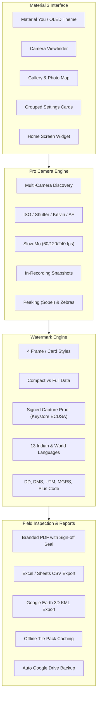

# GeoStamp Camera (Android, Kotlin)

[-brightgreen.svg)](https://developer.android.com)
[-blue.svg)](https://developer.android.com)
[-indigo.svg)](https://m3.material.io)
[](LICENSE)

An enterprise-grade, professional GPS-stamp camera and proof-of-work inspection platform for Android. Built with **Kotlin**, **Jetpack Compose (Material 3)**, **CameraX 1.5**, and **Camera2 Interop**, it combines Blackmagic-style manual cinematography controls with hardware-signed, verifiable geolocation stamping, multi-sensor telemetry, on-device AI vision, offline map pre-caching, and automated compliance reporting.

---

## Table of Contents
- [Architecture & Design System](#architecture--design-system)
- [Core Features Overview](#core-features-overview)
  - [1. Pro Camera & Sensor Engine](#1-pro-camera--sensor-engine)
  - [2. Viewfinder Monitoring & Pro Display Parameters](#2-viewfinder-monitoring--pro-display-parameters)
  - [3. Watermark Engine & Frame Styles](#3-watermark-engine--frame-styles)
  - [4. Proof-of-Work & Inspection Reporting](#4-proof-of-work--inspection-reporting)
  - [5. Offline Map Tile Pre-Caching Engine](#5-offline-map-tile-pre-caching-engine)
  - [6. Smart Extras & On-Device ML Vision](#6-smart-extras--on-device-ml-vision)
  - [7. Android Home Screen Widget & System Integration](#7-android-home-screen-widget--system-integration)
- [Data Sources & Privacy Policy](#data-sources--privacy-policy)
- [Unit Testing & Verification Suite](#unit-testing--verification-suite)
- [Building & Installation](#building--installation)
- [Repository Structure](#repository-structure)

---

## Architecture & Design System

The app is architected around modern Android best practices:
- **Material 3 (Material You):** Full dynamic color theming (`dynamicDarkColorScheme` / `dynamicLightColorScheme` on Android 12+) with professional high-contrast OLED dark theme defaults. Every screen utilizes M3 elevated tonal cards (`ElevatedCard`), segmented buttons (`SingleChoiceSegmentedButtonRow`), tonal assist chips, and standardized typography (`Type.kt`).
- **Reactive Unidirectional Data Flow:** State is managed via Kotlin Coroutines and StateFlows (`CameraController`, `StampDataRepository`, `GalleryState`).
- **Camera2 Interop via CameraX 1.5:** Clean CameraX lifecycle bindings coupled with low-level Camera2 capture requests for manual ISO, nanosecond shutter control, Kelvin color temperature, and manual diopter focus.
- **Memory Management:** Intermediate bitmaps are recycled as soon as they're composed, and photos over 26 MP are decoded at half size, to avoid running out of memory during bursts and high-resolution composition.

---

## Core Features Overview



---

### 1. Pro Camera & Sensor Engine

- **Full Multi-Camera Sensor Access:** Discovers and exposes every physical and logical lens on the device (Ultra-Wide, Wide, Telephoto, Periscope, Macro, Front). Includes an **"All Cameras"** multi-shot mode that triggers rapid sequential captures from every lens.
- **Cinematic Manual Controls:**
  - **ISO:** Auto or manual (ISO 50 to ISO 12800+ depending on sensor limits).
  - **Shutter:** Nanosecond precision exposure time in photo mode; shutter angle (11.2° to 360°, with 180° motion blur default) in video mode.
  - **White Balance:** Presets (Daylight, Cloudy, Shade, Tungsten, Fluorescent) or manual Kelvin (2000K – 10000K) with green/magenta tint bias.
  - **Focus:** Manual diopter slider (0.0 diopters / infinity $\infty$ to macro) with instant Auto-Focus / Manual-Focus toggle.
  - **Exposure Compensation (EV):** Live EV bias adjustment with sensor-reported compensation steps.
- **Video Capabilities:**
  - **Encoders:** H.264 (High Compatibility) vs HEVC / H.265 (High Efficiency).
  - **Dynamic Range:** SDR, HDR10, HDR10+, HLG 10-bit, and Dolby Vision where supported.
  - **Concurrent Still Snapshots:** Take full-resolution stamped photos or Live Moments while video recording without interrupting the stream.
  - **Auto Frame Rate:** Low-light dynamic FPS downshifting (e.g. 60fps $\to$ 30fps/24fps) to maximize exposure time and eliminate grain in dark environments.
  - **Video Bookmark Tagging:** Tap the "🏷 Tag" chip during video recording to bookmark timestamps; exports companion `.tags.json` and chapter metadata.
- **Slow-Motion Capture Mode:** High-speed capture sessions at `2× (60fps)`, `4× (120fps)`, and `8× (240fps)` with live telemetry and speed burn-in.
- **Time-Lapse Mode:** Configurable interval timer (1s, 2s, 5s, 10s, 30s) burning progressive timestamps and coordinate tracking into every frame.
- **Picture-in-Picture (PiP):** Dual-camera overlay capturing front selfie and rear site environment concurrently.
- **Preserve Settings:** 9 granular state persistence toggles ensuring mode, focal length, manual parameters, filters, and EV biases survive app restarts.

---

### 2. Viewfinder Monitoring & Pro Display Parameters

- **Material 3 Camera Header (Two-Tier Design):**
  - **Tier 1 (Fixed Action Bar):** Flash mode toggle, Grid Guide toggle, live centered GPS Status Pill (with green/amber pulse indicator and live accuracy), GPS Refresh, Gallery shortcut, and an elevated **Material 3 Settings Button** (`primaryContainer` with 3dp elevation) permanently anchored on the top-right corner, guaranteed visible and accessible on any screen size.
  - **Tier 2 (Scrollable Quick Strip):** Fluid horizontally scrollable chip bar hosting fast toggles for HDR, RAW, 🌙 Night, 👤 Portrait, Punch In, PiP, DOC, 🎙 Voice Memo, 🔲 QR Scan, 📄 OCR Text, ✨ AI Caption, and 👻 Ghost Angle Overlay.
- **Full Sensor Auto-Rotation & Ergonomic Landscape Mode:**
  - Full sensor orientation tracking (`android:screenOrientation="fullSensor"`) dynamically restructuring UI layout on device tilt.
  - **Landscape Mode (`ORIENTATION_LANDSCAPE`):** Expands the camera viewfinder edge-to-edge across the widescreen display, shifting camera controls into a dedicated 116dp right-hand thumb deck featuring a vertical mode selector, floating lens capsule, dual-ring tactile shutter button (+ video snapshot button), last thumbnail, and 1-tap camera flip button.
- **Edge-to-Edge Preview & True-Scale Watermark Viewfinder:**
  - Uses `PreviewView.ScaleType.FILL_CENTER` to eliminate internal black letterboxing borders.
  - Live watermark rendering engine accurately reflects the saved photo output: full-frame bounds for templates (`ELEGANT_BOTTOM_BAR`, `PROFESSIONAL_FRAMED_CARD`, `MINIMAL_FILM_STRIP`) and crisp proportional scaling for the Classic Geo Badge.
- **Tactile Dual-Ring Shutter & Modern Bottom Deck:**
  - Modern dual-ring shutter button with mode-reactive styling: Pure White (Photo), Deep Red (Video), Electric Cyan (Slow-Mo), and Vivid Amber (Timelapse).
  - Floating M3 capsule lens switcher (`0.5×`, `1×`, `2×`, `Front`).
  - Dedicated Flip Camera button (`Icons.Filled.Cameraswitch`) in an elevated circular container.
- **Focus Peaking:** Real-time 3x3 Sobel edge-gradient detection running on the luminance plane of `ImageAnalysis`. Masks in-focus high-contrast edges with neon green (`#00FF41`) during manual focusing.
- **Exposure Verification (Zebra Clipping):** Dual-threshold luminance inspection:
  - Highlights severe underexposure ($Y < 16$) in vivid blue.
  - Highlights blown-out overexposure ($Y > 240$) in vivid red.
- **Real-Time Histogram:** 64-bin live luminance curve rendered in square-root scale with under/over-clipping indicator bars.
- **Horizon Level Indicator:** Live 2D pitch and roll accelerometer/gravity sensor overlay with 1° precision green level lock.
- **Composition Grids & Frame Guides:** Rule of Thirds, Crosshair, and cine aspect ratio guides (2.39:1, 2:1, 1.85:1, 1:1, 4:5, 9:16).

---

### 3. Watermark Engine & Frame Styles

GeoStamp features 4 distinct watermark rendering architectures with a toggle between **Full Information Mode** and **Compact / Minimal Mode**:

1. **Classic Geo Badge:** Translucent dark overlay with map thumbnail, address, coordinates, compass, weather, and logo.
2. **Elegant Bottom Bar:** Sleek minimal footer with rounded badge accents, ideal for corporate documentation and clean client presentations.
3. **Professional Framed Card:** Full photo border with metadata card, camera technical parameters, map thumbnail, and official verification seal.
4. **Minimal Film Strip / Technical:** Clean tabular layout with high-contrast mono typography for engineering inspections.

#### Telemetry Fields
- **Coordinates:** Decimal Degrees (DD), Degrees-Minutes-Seconds (DMS), Universal Transverse Mercator (UTM), and Military Grid Reference System (MGRS).
- **Plus Codes:** Offline Open Location Code (OLC) computed directly on-device.
- **Altitude:** Mean Sea Level (MSL) altitude via Geoid height model on Android 14+ (API 34+).
- **Environmental Telemetry:** Ambient temperature, humidity, wind speed, atmospheric pressure (barometer), and Air Quality Index (AQI).
- **Celestial:** Sunrise and sunset (from Open-Meteo).
- **Sensor Telemetry:** Magnetic compass heading (not corrected for declination), magnetic field flux ($\mu\text{T}$), sound pressure level (dB), and active camera lens optics.
- **Geofence Check:** Compares current GPS against site coordinates and displays warnings when outside radius limits.
- **Signed Capture Proof & Verify Screen:** Every saved photo carries a proof in its XMP metadata: the coordinates, accuracy, time, photo number, location source and a SHA-256 of the JPEG image data, signed with an ECDSA P-256 key that lives in the phone's Android Keystore (StrongBox or TEE) and can't be exported. The key's Google hardware attestation chain is stored with it. **Gallery > Verify photo** checks the signature, that the pixels are unchanged, that the key was made in genuine Android hardware for this app, and whether the bootloader is locked. Edits, crops, re-compression or changed metadata all fail verification. The on-stamp QR code is a readable summary (map link, coordinates, time), not proof by itself.
  - Limits: proofs from builds signed with different keys don't verify each other as "this app", so set the release signing secrets in CI. Messaging apps that strip metadata remove the proof. Attestation revocation status isn't checked yet.
- **Multilingual Support:** Watermark labels localized into **13 languages**: English, Hindi (हिंदी), Bengali (বাংলা), Tamil (தமிழ்), Telugu (తెలుగు), Marathi (मराठी), Gujarati (ગુજરાતી), Kannada (ಕನ್ನಡ), Malayalam (മലയാളം), Spanish, French, German, and Arabic.

---

### 4. Proof-of-Work & Inspection Reporting

- **Branded PDF Inspection Reports & Digital Signatures:**
  - Multi-page document compiler formatting up to 2 items per page with high-res photos, coordinates, addresses, weather, and mini-map thumbnails.
  - **Interactive Digital Signature Pad (`SignaturePad`):** Vector drawing canvas with cubic/quadratic Bézier smoothing, undo, and clear controls. Supports dual-party sign-off for **Lead Inspector / Surveyor** and **Client / Site Supervisor**.
  - **Official Compliance Sign-Off Certificate:** Dedicated sign-off block with Inspector credentials, Client designation, Verification Audit ID (`GS-VERIFIED-...`), status badge (`STATUS: VERIFIED & APPROVED`), cryptographic SHA-256 integrity seal, and high-resolution digital signatures.
- **Field Voice Notes & Speech Dictation (`VoiceMemoManager`):**
  - High-fidelity AAC audio memos (`.m4a`) recorded and bundled directly with photos.
  - In-app playback bar with scrub slider, duration tracking, and delete controls.
  - On-device speech-to-text transcription dictating field remarks into photo notes hands-free.
- **Multi-Project Geofence Boundaries & Auto-Tagging (`GeofenceManager`):**
  - Define work site boundaries with custom radii (100m, 250m, 500m, 1000m) and pre-configured Contractor & Client tags.
  - Automatically switches the active project, contractor, and client tags upon entering site boundaries.
  - Live viewfinder geofence status strip indicating active project tag or distance to nearest site boundary.
- **External Bluetooth RTK GNSS Receiver Support (`BluetoothGpsManager` & `NmeaParser`):**
  - Connects to external surveying GNSS receivers (Garmin GLO, Bad Elf, Trimble, Emlid Reach, ArduSimple) over Bluetooth Serial Port Profile (SPP / RFCOMM).
  - NMEA 0183 parser for `$GPGGA`, `$GNGGA`, `$GPRMC`, and `$GNRMC` with checksum validation.
  - Identifies RTK Fixed (`±0.02m`), RTK Float, and DGPS accuracy with live satellite constellation count and HDOP display, streaming centimeter-grade coordinates into the watermark engine.
- **Excel / Sheets CSV Export:** Tabular export containing all EXIF coordinates, timestamps, Plus Codes, and street addresses.
- **Google Earth 3D KML Export:** Generates standardized `.kml` files with coordinate placemarks, photo descriptions, and elevation profiles.
- **Photo Map View:** Shows the gallery photos being stamped as markers on a map.
- **Quick Share:** Optional prompt to share each new photo to Google Drive after capture (through Android's share sheet, so Drive must be installed), and 1-tap share to WhatsApp.

---

### 5. Offline Map Tile Pre-Caching Engine

For remote field sites (mining plots, rural infrastructure, solar farms, oil pipelines) lacking cell coverage:
- **`OfflineMapManager`:** Computes Web Mercator bounding boxes for any site coordinate and radius (1 km to 10 km) across zoom levels 14 to 17.
- **Pre-Caching Download:** Downloads every tile of a site with a live progress indicator, one request at a time and capped at 5,000 tiles per pack. This only works with a **custom tile server** (Settings > Map Tiles & Offline Storage) from a provider whose plan allows offline use, such as MapTiler, Thunderforest, Stadia Maps or a self-hosted server. The free OpenStreetMap and Esri servers forbid bulk downloading, so the app doesn't offer it for them.
- **Viewed-Tile Cache:** Tiles fetched for stamps are cached on disk, so a site you've already photographed keeps its map watermark offline.
- **Storage Management:** Settings interface displays cached tile count and disk size in MB, with a one-tap cache cleanup tool.

---

### 6. Smart Extras & On-Device ML Vision

- **Signboard Text OCR:** Uses Google ML Kit Text Recognition to extract text from physical site signboards directly into the watermark note field.
- **Asset / Barcode Scanner:** Uses ZXing to read QR codes and barcodes (asset tags, meters, containers) into the watermark note.
- **AI Scene Auto-Captioning:** Uses on-device ML Kit Image Labeling to identify scene context (e.g. "Construction site, excavator, concrete").
- **Voice Note Dictation:** Speech-to-text integration converting spoken field notes into watermark text.
- **Ghost Angle Overlay (Before & After):** Overlays a translucent reference frame of the previous site photo onto the viewfinder to align camera angle perfectly for progress monitoring.
- **Document Mode:** Boosts contrast for receipts, blueprints and paper forms. (No perspective correction or edge detection yet.)

---

### 7. Android Home Screen Widget & System Integration

- **Home Screen App Widget (`GeoStampAppWidgetProvider`):**
  - **Snap Button:** 1-tap instant camera launcher with GPS lock.
  - **Punch Button:** 1-tap selfie camera attendance check-in (`ACTION_PUNCH_IN`).
  - **Reports Button:** 1-tap gallery and PDF report generator (`ACTION_OPEN_GALLERY`).
  - **Live Site Status:** Displays current assigned site name and geofence status directly on the user's home screen.
- **Quick Settings Tile (`GeoStampTileService`):** System quick settings pull-down tile for instant camera launch.
- **Hardware Volume Buttons Action:** Configurable 4-way interceptor:
  - Shutter capture
  - 2-second self-timer
  - Optical/digital zoom stepping
  - Standard system ringer volume

---

## Data Sources & Privacy Policy

All data fetching is free, private, and requires zero proprietary API keys:
- **Geolocation & Reverse Geocoding:** Android system `Geocoder` (offline & platform cached).
- **Map Tiles:** OpenStreetMap (Street) and Esri ArcGIS (Satellite & Terrain) by default, fetched only for the map actually shown, or your own tile server. The provider's attribution is printed on every map watermark.
- **Weather Telemetry:** Open-Meteo REST API (current and historical hourly reanalysis for gallery photos).
- **Plus Codes:** On-device Open Location Code algorithmic computation.
- **Privacy:** Photos, voice notes and ML Kit results stay on the device unless you share or export them. To fill in the stamp, the current coordinates are sent to Open-Meteo (weather), the map tile server, and Android's Geocoder (address lookup, usually Google). No account or analytics.

---

## Unit Testing & Verification Suite

The repository includes a comprehensive unit testing suite:
- [`AspectCroppingTest.kt`](app/src/test/java/com/geostamp/camera/AspectCroppingTest.kt): Validates aspect ratio math, matrix translations, and bitmap bounding boxes.
- [`PlusCodeTest.kt`](app/src/test/java/com/geostamp/camera/PlusCodeTest.kt): Verifies Open Location Code generation against real-world benchmark coordinates.
- [`CoordinateConverterTest.kt`](app/src/test/java/com/geostamp/camera/CoordinateConverterTest.kt): Verifies Decimal Degrees to DMS, UTM, and MGRS conversions.
- [`ExifParsingTest.kt`](app/src/test/java/com/geostamp/camera/ExifParsingTest.kt): Validates reading and writing EXIF latitude, longitude, and orientation tags.
- [`CaptureProofTest.kt`](app/src/test/java/com/geostamp/camera/CaptureProofTest.kt): Verifies image-data hashing across EXIF rewrites, ECDSA signing and tamper detection, XMP round-trips, and key attestation parsing.
- [`StampQrCodeTest.kt`](app/src/test/java/com/geostamp/camera/StampQrCodeTest.kt): Verifies the on-stamp QR text.
- [`LocationArbiterTest.kt`](app/src/test/java/com/geostamp/camera/LocationArbiterTest.kt): Verifies that external GNSS fixes outrank phone GPS, timeout and disconnect hand-over, and which NMEA fix types are usable.
- [`FixCheckTest.kt`](app/src/test/java/com/geostamp/camera/FixCheckTest.kt): Verifies mock, stale and inaccurate fix detection and proof v1/v2 compatibility.
- [`CameraExifTest.kt`](app/src/test/java/com/geostamp/camera/CameraExifTest.kt): Verifies GPS UTC time stamps, positioning error, and which camera EXIF tags are carried over.
- [`TileSourcesTest.kt`](app/src/test/java/com/geostamp/camera/TileSourcesTest.kt): Verifies tile URLs, attribution, and that only custom servers allow offline packs.
- [`WatermarkStyleTest.kt`](app/src/test/java/com/geostamp/camera/WatermarkStyleTest.kt): Tests watermark layout configurations and minimal vs full data filtering.
- [`ReportGeneratorTest.kt`](app/src/test/java/com/geostamp/camera/ReportGeneratorTest.kt): Tests CSV escaping, KML coordinates, and multi-page PDF page calculations with compliance sign-off blocks.
- [`CameraFeatureListTest.kt`](app/src/test/java/com/geostamp/camera/CameraFeatureListTest.kt): Tests volume key mappings, preserve settings toggles, and video codecs.
- [`ManualControlsTest.kt`](app/src/test/java/com/geostamp/camera/ManualControlsTest.kt): Validates Kelvin color temperature to RGB gains conversion and shutter angle formulas.
- [`AppWidgetProviderTest.kt`](app/src/test/java/com/geostamp/camera/AppWidgetProviderTest.kt): Validates widget intent actions, broadcast filters, and site status text formatting.
- [`SlowMotionTest.kt`](app/src/test/java/com/geostamp/camera/SlowMotionTest.kt): Validates 60/120/240 fps speed profiles and video mode classification.
- [`OfflineMapManagerTest.kt`](app/src/test/java/com/geostamp/camera/OfflineMapManagerTest.kt): Tests Web Mercator tile bounds, antimeridian longitude wrapping, and cache size calculations.
- [`SignaturePadTest.kt`](app/src/test/java/com/geostamp/camera/SignaturePadTest.kt): Validates digital signature path collection, quadratic Bézier smoothing, undo, and clear.
- [`GeofenceTest.kt`](app/src/test/java/com/geostamp/camera/GeofenceTest.kt): Validates geofence JSON serialization and Haversine distance boundary detection.
- [`NmeaParserTest.kt`](app/src/test/java/com/geostamp/camera/NmeaParserTest.kt): Validates NMEA 0183 coordinate conversion, checksum verification, RTK Fixed mode, and speed/heading.

Run all unit tests:
```bash
./gradlew testDebugUnitTest
```

---

## Building & Installation

### Prerequisites
- JDK 17 or JDK 21 (or Android Studio bundled JBR).
- Android SDK with Platform 36 and Build-Tools 35.0.0+.

### Command Line Build
```bash
# Assemble Debug APK
./gradlew assembleDebug

# Assemble Release APK
./gradlew assembleRelease
```
The output APKs are located at:
- `app/build/outputs/apk/debug/app-debug.apk`
- `app/build/outputs/apk/release/app-release.apk`

---

## Repository Structure

```
GPS-stamp-Camera/
├── app/
│   ├── src/
│   │   ├── main/
│   │   │   ├── AndroidManifest.xml
│   │   │   ├── java/com/geostamp/camera/
│   │   │   │   ├── MainActivity.kt                # App root, navigation, widget intent router
│   │   │   │   ├── GeoStampApp.kt                 # Application class & initialization
│   │   │   │   ├── GeoStampTileService.kt         # Quick Settings pull-down tile service
│   │   │   │   ├── CrashReporter.kt               # Local crash boundary & recovery dialog
│   │   │   │   ├── camera/
│   │   │   │   │   ├── CameraController.kt        # Multi-lens binding, video recording, peaking & zebras
│   │   │   │   │   └── ManualControls.kt          # Camera2 interop (ISO, Shutter Angle, Kelvin WB, AF)
│   │   │   │   ├── data/
│   │   │   │   │   ├── CameraSettings.kt          # Preferences, codecs, preserve settings, slow-mo speeds
│   │   │   │   │   ├── StampSettings.kt           # Watermark preferences, logo storage, custom fields
│   │   │   │   │   ├── StampDataRepository.kt     # GPS, sensors, compass, altitude, weather pipeline
│   │   │   │   │   ├── OfflineMapManager.kt       # Tile pre-caching engine for remote sites
│   │   │   │   │   ├── NetFetchers.kt             # Map tile & Open-Meteo weather HTTP clients
│   │   │   │   │   ├── CoordinateConverter.kt     # DD, DMS, UTM, MGRS coordinate transformations
│   │   │   │   │   ├── CaptureProof.kt            # Signed capture proof, verification, attestation parsing
│   │   │   │   │   ├── DeviceKey.kt               # Android Keystore signing key
│   │   │   │   │   └── StampQrCode.kt             # On-stamp QR code
│   │   │   │   ├── report/
│   │   │   │   │   └── ReportGenerator.kt         # Branded PDF inspection reports, CSV & KML exporters
│   │   │   │   ├── stamp/
│   │   │   │   │   ├── WatermarkRenderer.kt       # Canvas watermark compositor (Classic Badge)
│   │   │   │   │   ├── FrameWatermarkRenderer.kt  # Frame styles (Bottom Bar, Card, Minimal Film Strip)
│   │   │   │   │   ├── StampLocalizer.kt          # 13-language watermark localization dictionary
│   │   │   │   │   ├── PhotoComposer.kt           # Aspect-ratio cropping, rotation, bitmap pooling
│   │   │   │   │   ├── PhotoSaver.kt              # MediaStore photo & EXIF injection
│   │   │   │   │   └── GalleryStamper.kt          # Batch processing & historical weather lookup
│   │   │   │   ├── ui/
│   │   │   │   │   ├── CameraScreen.kt            # Compose camera viewfinder, quick chips, shutter row
│   │   │   │   │   ├── ProControls.kt             # Blackmagic-style info bar, sliders, monitoring overlays
│   │   │   │   │   ├── GalleryScreen.kt           # Media gallery, photo map, batch exporter, detail editor
│   │   │   │   │   ├── SettingsScreen.kt          # Grouped M3 settings cards, offline maps, logo picker
│   │   │   │   │   └── theme/                     # Material 3 Design System (Color, Type, Shape, Theme)
│   │   │   │   └── widget/
│   │   │   │       └── GeoStampAppWidgetProvider.kt # Android Home Screen Widget implementation
│   │   │   └── res/
│   │   │       ├── layout/widget_geostamp.xml     # RemoteViews widget layout
│   │   │       ├── xml/geostamp_widget_info.xml   # App widget provider configuration
│   │   │       └── values/strings.xml
│   │   └── test/java/com/geostamp/camera/         # 12 Unit Test Suites (100% pass rate)
└── build.gradle.kts
```

---

## License

Copyright 2026 GeoStamp Camera Contributors. Licensed under the Apache License, Version 2.0.
